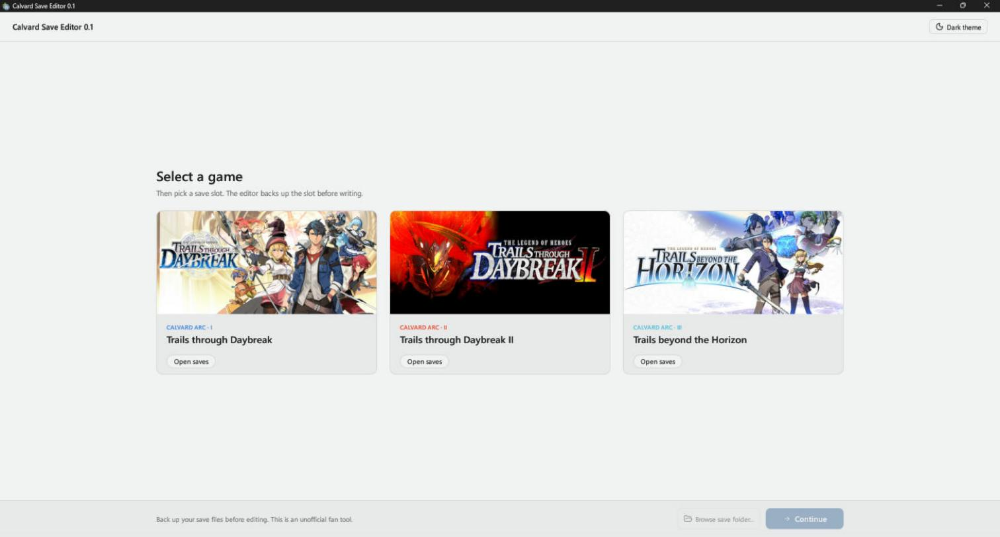
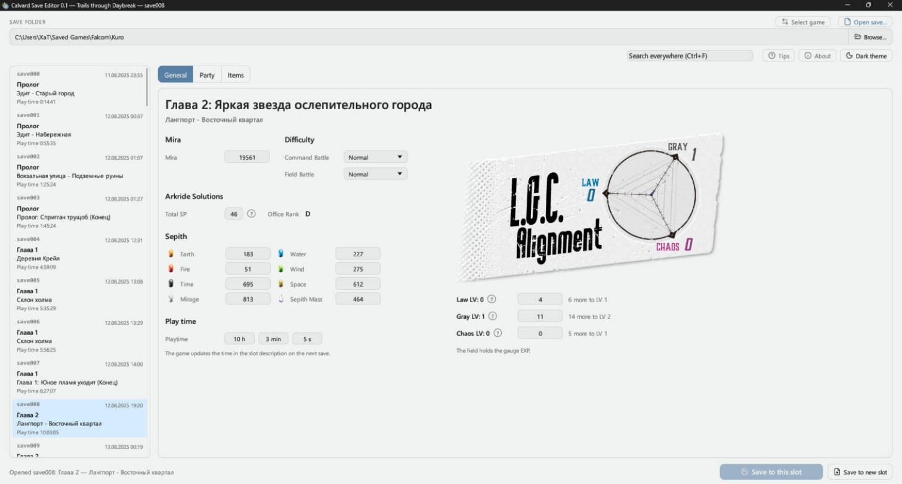
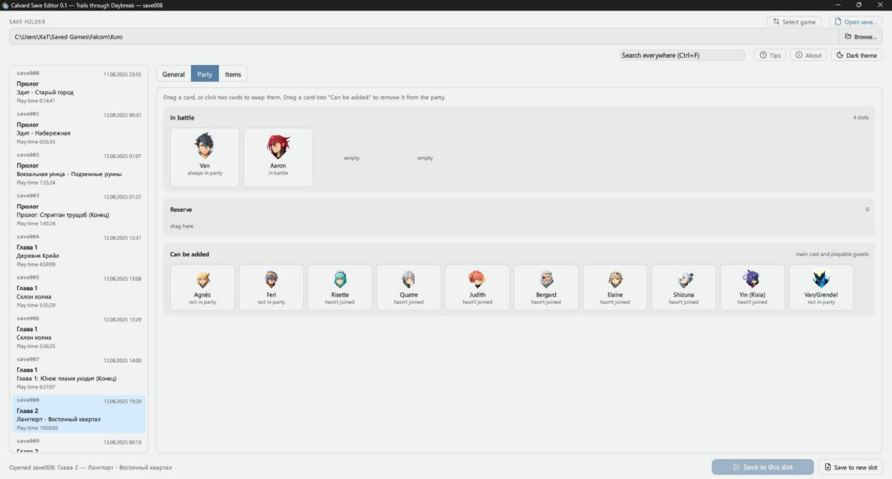
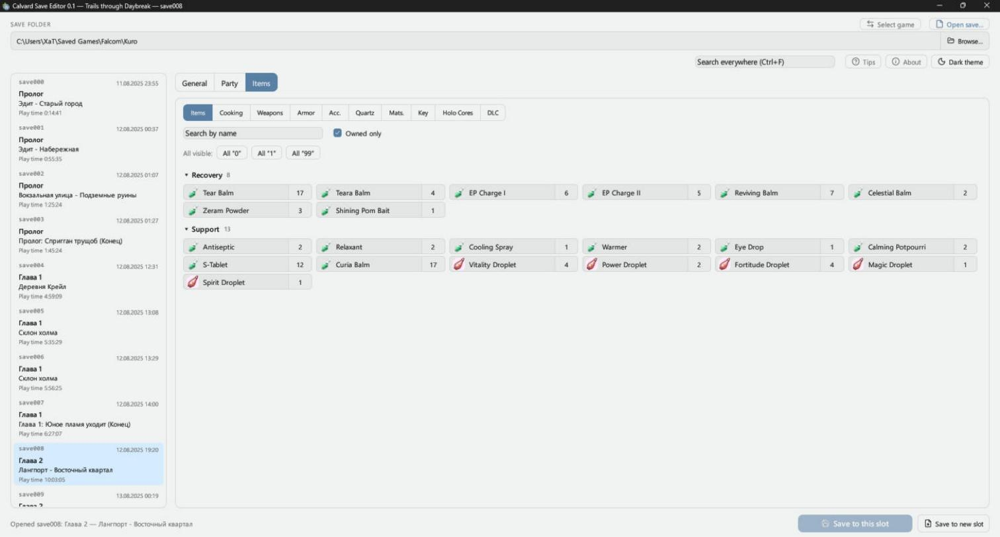
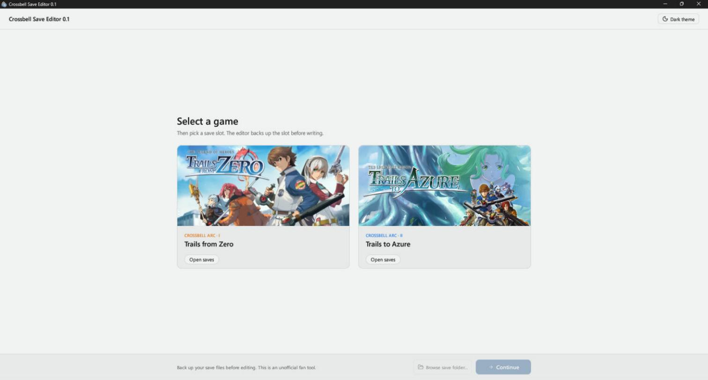
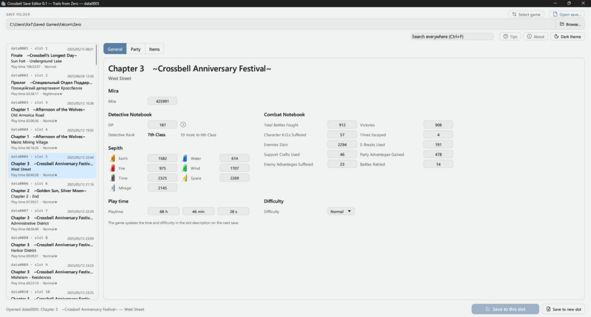
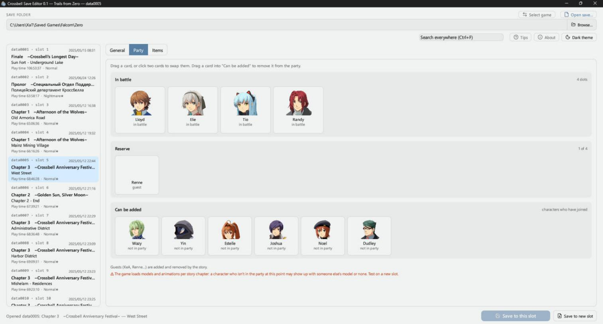
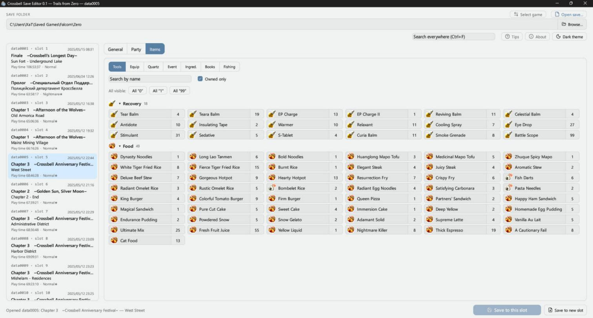

# Trails Save Editor

[English](README.md) · **Русский**

Редакторы сохранений для серии The Legend of Heroes (PC, Steam):

| Программа | Игры |
|---|---|
| **SE-Calvard** (`Calvard-SaveEditor.exe`) | Trails through Daybreak, Trails through Daybreak II, Trails beyond the Horizon |
| **SE-Crossbell** (`Crossbell-SaveEditor.exe`) | Trails from Zero, Trails to Azure |

Интерфейс программы на английском.

## Что умеют

- **Общее** — мира, сепит, сложность, время игры; у Калварда — Total SP и ранг Arkride Solutions, шкалы L.G.C.
- **Отряд** — кто в бою, в запасе и кого можно добавить: перетаскивание карточек или два щелчка.
- **Предметы** — количество любых предметов со значками и разделами, как в игре; поиск по названию.
- Поиск по всем вкладкам (Ctrl+F), светлая и тёмная тема.
- Контрольную сумму сохранения редактор пересчитывает сам.
- Перед записью слот копируется в папку `Backups` рядом с программой.

## Скриншоты

SE-Calvard:









SE-Crossbell:









## Как пользоваться

1. Скачайте архив из [Releases](../../releases) и распакуйте в любую папку.
   Рядом с exe должен лежать `data.dat`: в нём значки предметов, портреты и таблицы игр — без него редактор не покажет предметы и персонажей.
2. Запустите редактор, выберите игру и слот сохранения.
3. Внесите изменения и нажмите «Save to this slot» или «Save to new slot».

Перед записью закройте игру или выйдите в главное меню. Держите свои копии сохранений.

## Сборка из исходников

Нужны Windows, [Rust](https://rustup.rs) и Visual Studio Build Tools (компилятор C++ и Windows SDK — для значков exe).

```
cargo build --release
```

Готовые `Calvard-SaveEditor.exe` и `Crossbell-SaveEditor.exe` — в `target\release`.
Игровых данных в репозитории нет: положите рядом с exe `data.dat` из архива релиза.

## Права

Код открыт для просмотра; лицензия на использование и изменение не выдаётся — все права у автора.

Значки кнопок (`src/icons/*.svg`, кроме `calvard_save.svg` и `crossbell_save.svg`) — из набора
[Lucide](https://lucide.dev), лицензия ISC: см. `src/icons/LICENSE`.

The Legend of Heroes, Trails through Daybreak, Trails beyond the Horizon, Trails from Zero и Trails to Azure —
товарные знаки Nihon Falcom Corporation. Проект не связан с Nihon Falcom и не одобрен ею.
Значки предметов, портреты и тексты игр в `data.dat` принадлежат Nihon Falcom.
